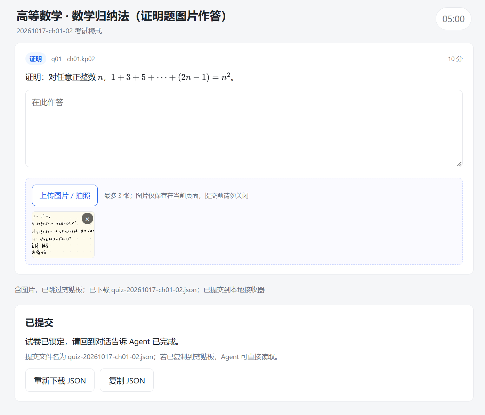
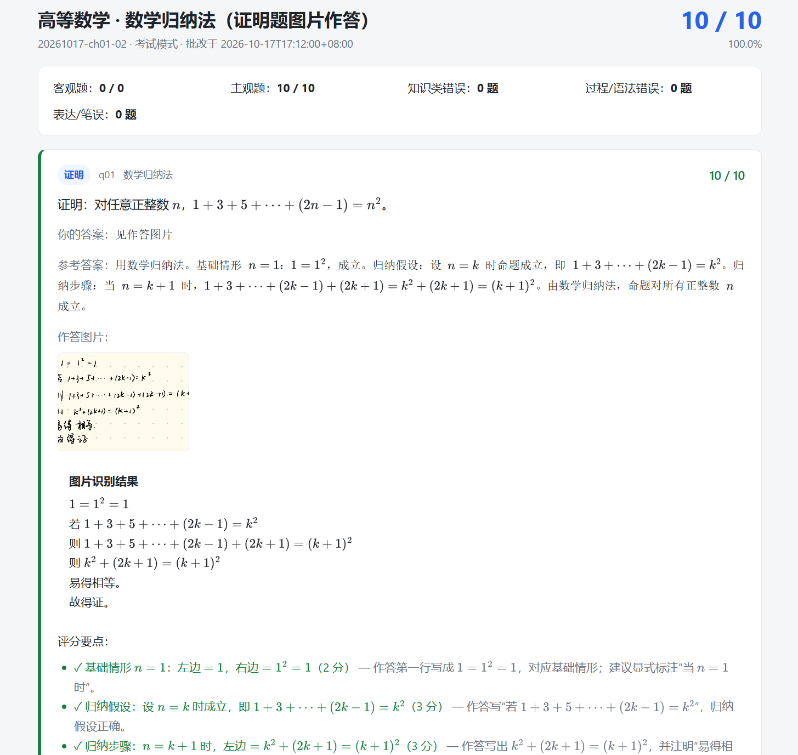

# chapter-coach

> **ChapterCoach · 章节教练** — 用本地 PPT 逐章学习、按期末考纲出题、浏览器答题、拍照提交、可追溯批改的自学助手。

一套面向 Codex、Claude Code、ZCode 等本地 AI Agent 的技能包。每个会话处理一章：先把课件整理成带页码的知识点，再按你的期末题型配置出题；浏览器作答（支持手写拍照），Agent 复算客观题、按 rubric 批改主观题，最后生成成绩、错题本和批改结果页。

## 截图

| 试卷页（含图片作答） | 批改结果页 |
| --- | --- |
|  |  |

## 目录

- [核心特性](#核心特性)
- [截图](#截图)
- [工作方式](#工作方式)
- [章节学习](#章节学习)
- [快速开始](#快速开始)
- [使用方法](#使用方法)
- [目录结构](#目录结构)
- [课程画像与题型](#课程画像与题型)
- [两种模式与答案下发](#两种模式与答案下发)
- [图片作答](#图片作答)
- [批改与学习状态](#批改与学习状态)
- [报告与错题本](#报告与错题本)
- [公式渲染](#公式渲染)
- [跨平台能力分级](#跨平台能力分级)
- [常见问题](#常见问题)
- [限制与路线图](#限制与路线图)
- [开发与测试](#开发与测试)
- [许可与致谢](#许可与致谢)

## 核心特性

- **逐章学习**：先给知识点总览，再按需深入；每个知识点都能回指 PPT 页码。
- **课程画像**：记录学科与期末考纲题型，数学出证明/计算，数据库出 SQL，编程出代码题，而不是一套题型套所有课。
- **每轮配置闸门**：模式、题数、题型分布、难度、范围都由你确认，不会静默使用默认值。
- **浏览器答题**：单文件离线 HTML，自动保存草稿，提交后通过 localhost / 下载 / 剪贴板回传。
- **图片作答**：证明、计算、作图、手写 SQL、长简答可以拍照上传；浏览器内压缩，本地落盘。
- **可追溯批改**：客观题由 Agent 复算；主观题按 rubric 逐点给分，必须给出“错在哪里 / 怎么改”。
- **语义判分**：同义表述、不同写法、不同解法都接受，不死扣字眼。
- **学习状态**：稳定知识点 ID、掌握度、下次复习时间、错题本，跨章节复用。
- **完整 LaTeX**：内联 MathJax 3.2.2（TeX→SVG），离线排版分式、根号、矩阵、cases 等。

## 工作方式

```text
PPT / PDF
   │
   ▼
extracted/*.md + knowledge/*.json      知识点与 slide 映射
   │
   ▼
plan.json → quiz.json                 覆盖计划与题目
   │
   ▼
exam.html                             单文件试卷（exam 模式不含答案）
   │
   ▼
submission.json + media/*.jpg         浏览器作答与图片
   │
   ▼
Agent 批改 → result.json              客观题复算 + 主观题 rubric
   │
   ▼
state.json / attempts / report.md / wrongbook.md / review.html
```

一条重要分工：**脚本只做确定性的抽取、校验、构建、落盘和记账；评分由 Agent 完成。** `apply_result.py` 不会替你判分，它只接收已经写好的 `result.json`。

## 章节学习

学习是对话式的，不需要先出题。推荐路径：**总览 → 追问 → 出题 → 批改**。

```text
PPT
 ↓ 抽取
knowledge/ch03.json          每个知识点：标题、摘要、slide 页码
 ↓
总览（一屏）                  每个 KP 1–2 句 + slide 号
 ↓ 你追问某个 KP
单点讲解                      只读取该 KP 的 slide，按需深入
 ↓ 学完
配置闸门 → 命题 → 答题 → 批改
```

### 1. 总览

你可以直接说：

> 用 `ch03.pptx` 学第三章，先给我知识点总览。

Agent 会从 `knowledge/ch03.json` 生成类似：

> 本章 6 个知识点：
> - `ch03.kp01` 函数依赖（PPT 第 5–6 页）：属性间的决定关系，候选键是最小决定集。
> - `ch03.kp02` 范式与规范化（第 8–10 页）：2NF/3NF/BCNF 逐级消除部分依赖与传递依赖。
> - `ch03.kp03` ER 图转关系模式（第 14–16 页）：按联系基数决定是否单独建表。
> - …

总览只给标题、1–2 句摘要和页码，不会把整章原文一次倒出来；这样上下文不会被撑爆。

### 2. 追问

看到不熟的点，直接追问：

> 讲讲 `ch03.kp04`，特别是 3NF 和 BCNF 的区别。

Agent 只读取 `ch03.kp04` 对应的 slide，展开讲解。PPT 没覆盖、属于补充的内容会明确标注，不会混在课件原文里。你也可以要求它举例、对比、画表格，或回到某一张 slide 逐句解释。

### 3. 出题

学完一章后，Agent 会先给你配置表：

| 项目 | 例子 |
| --- | --- |
| 模式 | practice / exam |
| 题数 | 8 |
| 题型 | 单选 4、简答 2、SQL 2 |
| 难度 | 3 |
| 范围 | 仅本章 / 含历史复习 |

确认后才生成覆盖计划、题目、质检结果和 `exam.html`。不会静默使用默认值。

### 4. 批改

在浏览器提交后：

1. Agent 读取 `submission.json` 和 `media/` 里的图片；
2. 客观题复算，主观题按 rubric 逐点给分；
3. 写入 `result.json`；
4. 更新 `state.json`、`wrongbook.md`，生成 `report.md` 和 `review.html`；
5. 在对话里告诉你得分、错在哪、下次复习时间。

### 产物位置

| 阶段 | 产物 |
| --- | --- |
| 学习 | `.ppt-tutor/knowledge/ch03.json` |
| 出题 | `.ppt-tutor/sessions/<quiz_id>/plan.json`、`quiz.json`、`exam.html` |
| 答题 | `.ppt-tutor/sessions/<quiz_id>/submission.json`、`media/` |
| 批改 | `.ppt-tutor/sessions/<quiz_id>/result.json`、`report.md`、`review.html` |
| 长期状态 | `.ppt-tutor/state.json`、`wrongbook.md`、`attempts/` |

学习阶段本身不生成 HTML；HTML 只用于答题和批改结果页。

## 快速开始

### 前置条件

- **A 档（推荐）**：Python 3.10+，安装 `python-pptx`。
- **B 档**：无 Python，但能解压 PPTX / 调用 LibreOffice / 读取文本。
- **C 档**：只有文件读写能力，使用下载或剪贴板回传。

没有 Python 也能用，只是抽取、SQL 执行、Word 导出、localhost 接收器等能力会降级。见[跨平台能力分级](#跨平台能力分级)。

### 安装

把整个目录放到所用 Agent 的技能目录：

| 平台 | 位置 |
| --- | --- |
| ZCode | `~/.zcode/skills/chapter-coach/` |
| Claude Code | `~/.claude/skills/chapter-coach/` |
| Codex | 按该平台的 skill 目录约定放置 |

`SKILL.md` 的 frontmatter 名称是 `chapter-coach`。如果加载器要求目录名与技能名一致，把目录重命名为 `chapter-coach` 即可。

### 最小流程

```bash
# 1. 抽取课件（A 档）
python scripts/extract_pptx.py ch03.pptx --chapter-id ch03 --out .ppt-tutor

# 2. 依据 extracted/ch03.md 生成 knowledge/ch03.json（由 Agent 完成）

# 3. 题目质检
python scripts/validate_quiz.py quiz.json \
  --course .ppt-tutor/course.json \
  --knowledge .ppt-tutor/knowledge/ch03.json

# 4. 构建试卷（exam 模式自动剥离答案）
python scripts/build_exam.py quiz.json \
  --template assets/exam-template.html \
  --mode exam --include-answers auto \
  --out .ppt-tutor/sessions/<quiz_id>/exam.html \
  --channel post \
  --endpoint http://127.0.0.1:8765/submit \
  --token <random-token>

# 5. 启动一次性接收器并打开试卷
python scripts/receive_submission.py \
  --dir .ppt-tutor/sessions/<quiz_id> \
  --port 8765 --token <random-token> --timeout 3600 --open

# 6. Agent 批改生成 result.json 后，落状态与报告
python scripts/apply_result.py \
  --result .ppt-tutor/sessions/<quiz_id>/result.json \
  --quiz .ppt-tutor/sessions/<quiz_id>/quiz.json \
  --knowledge .ppt-tutor/knowledge/ch03.json \
  --submission .ppt-tutor/sessions/<quiz_id>/submission.json \
  --state .ppt-tutor/state.json \
  --session .ppt-tutor/sessions/<quiz_id> \
  --course-id <course> --today <YYYY-MM-DD>

# 7. 生成批改结果页
python scripts/build_review.py \
  --quiz .ppt-tutor/sessions/<quiz_id>/quiz.json \
  --result .ppt-tutor/sessions/<quiz_id>/result.json \
  --submission .ppt-tutor/sessions/<quiz_id>/submission.json \
  --knowledge .ppt-tutor/knowledge/ch03.json \
  --template assets/review-template.html \
  --out .ppt-tutor/sessions/<quiz_id>/review.html
```

`build_exam.py --include-answers` 的行为：

- `auto`（默认）：practice 注入答案，exam 剥离 `answer/rubric/explanation/accepted_answers/expected_rows`
- `never`：任何模式都不注入
- `always`：任何模式都注入（只建议练习）

## 使用方法

这一节说明：技能怎么装、课程资料怎么给、结果在哪里。

### 1.安装技能
安装位置：

- ZCode：`~/.zcode/skills/chapter-coach/`
- Claude Code：`~/.claude/skills/chapter-coach/`
- Codex：平台对应的 skill 目录

上传到 GitHub 时，`.gitignore` 已排除 `.ppt-tutor/`、`media/`、`*.pptx`、`*.ppt`。不要用网页拖拽的方式绕过 `.gitignore`。

### 2. 上传课程资料并开始

1. 在电脑上建一个课程目录，。
2. 把对应课程ppt放进去。
3. 对 Agent 说：“用 （ppt的路径名）学习（ppt名称），先给我知识点总览。”

Agent 会：

- 读取 PPT，生成 `.ppt-tutor/extracted/ch03.md`
- 建立 `.ppt-tutor/knowledge/ch03.json`，每个知识点映射到 slide
- 问你期末题型（如果 `course.json` 还没有），写入 `.ppt-tutor/course.json`

课程资料只在本地读取；除非你明确要求，不会上传到外部服务。

### 3. 出题前确认配置

每轮命题前，Agent 会给你一张配置表：

| 项目 | 例子 |
| --- | --- |
| 模式 | practice / exam |
| 题数 | 8 |
| 题型 | 单选 4、简答 2 |
| 难度 | 3 |
| 范围 | 仅本章 / 含历史复习 |

你确认后才会生成题目；说“默认”也会把实际配置写出来。

### 4. 答题与提交

Agent 生成 `sessions/<quiz_id>/exam.html` 并打开。你在浏览器里：

- 文字作答，或
- 点“上传图片 / 拍照”提交手写过程（证明、计算、作图、手写 SQL 等）

提交后，数据回到 Agent：

- localhost 接收器：直接写 `submission.json` 与 `media/`
- 下载/剪贴板：Agent 读取后调用 `extract_attachments.py`

### 5. 输出什么，在哪里

所有产物都在课程目录的 `.ppt-tutor/` 下：

| 产物 | 位置 | 用途 |
| --- | --- | --- |
| 知识点 | `.ppt-tutor/knowledge/ch03.json` | 章节结构、KP → slide 映射 |
| 试卷 | `.ppt-tutor/sessions/<quiz_id>/quiz.json` | 题目、答案、rubric |
| 答题页 | `.ppt-tutor/sessions/<quiz_id>/exam.html` | 浏览器作答 |
| 原始作答 | `.ppt-tutor/sessions/<quiz_id>/submission.json` | 文字与图片路径 |
| 作答图片 | `.ppt-tutor/sessions/<quiz_id>/media/` | 手写照片 |
| 批改结果 | `.ppt-tutor/sessions/<quiz_id>/result.json` | 逐题分数、rubric、证据 |
| Markdown 报告 | `.ppt-tutor/sessions/<quiz_id>/report.md` | 归档/编辑 |
| 结果页 | `.ppt-tutor/sessions/<quiz_id>/review.html` | 参考答案、错因、改法、原图 |
| 学习状态 | `.ppt-tutor/state.json` | 掌握度、下次复习 |
| 错题本 | `.ppt-tutor/wrongbook.md` | 按 KP 分组 |
| 逐题记录 | `.ppt-tutor/attempts/<quiz_id>.jsonl` | 审计与重批 |

### 6. 上传到 GitHub 时提交什么

提交：

- `SKILL.md`、`README.md`、`LICENSE`
- `references/`、`schemas/`、`assets/`、`scripts/`
- `docs/`（截图）
- 可选的合成示例

不要提交：

- `.ppt-tutor/`
- `media/`
- 任何 `*.pptx` / `*.ppt`
- 真实的作答照片、成绩、错题本
- 你所在课程的课件内容

发布前跑一次：

```bash
git status --ignored
```

确认没有课程资料被暂存。

## 目录结构

```text
.ppt-tutor/
├─ capabilities.json          # 本次会话环境探测
├─ course.json                # 学科、期末考纲、题型注册表
├─ state.json                 # 掌握度与复习计划（唯一真源）
├─ knowledge/ch03.json        # 知识点与 slide 映射
├─ extracted/ch03.md          # PPT 抽取缓存
├─ extracted/ch03.meta.json   # hash、页数、图片页
├─ sessions/<quiz_id>/
│  ├─ plan.json               # 覆盖计划
│  ├─ quiz.json               # 题目与答案（Agent 侧真源）
│  ├─ exam.html               # 单文件试卷
│  ├─ submission.json         # 原始作答
│  ├─ media/q09-1.jpg         # 作答图片
│  ├─ result.json             # 批改结果
│  ├─ report.md               # Markdown 报告
│  └─ review.html             # 批改结果页
├─ attempts/<quiz_id>.jsonl   # 逐题追加记录
└─ wrongbook.md               # 错题本（派生视图）
```

**JSON 是唯一真源**，Markdown 和 HTML 都是派生视图。重新批改时读 `quiz.json` + `result.json`，不要反向解析 Markdown。

## 课程画像与题型

`.ppt-tutor/course.json` 记录两件事：

```json
{
  "subject": "高等数学",
  "exam_blueprint": {
    "source": "user",
    "types": [
      { "type": "proof", "label": "证明题", "count": 2, "score": 20 },
      { "type": "calculation", "label": "计算题", "count": 5, "score": 60 }
    ]
  },
  "type_registry": [
    { "type": "proof", "label": "证明", "render": "text", "grading": "rubric" },
    { "type": "calculation", "label": "计算", "render": "text", "grading": "rubric" }
  ]
}
```

- `source` 为 `user` 时，按真实期末考纲缩放题型分布。
- `source` 为 `inferred` 时，从课件内容推断，并在配置时明确告诉你。
- `source` 为 `unknown` 时，只用材料能支撑的安全题型。

内置题型包括单选、多选、判断、填空、简答、设计、SQL、代码、证明、计算、解答、编程、作图、翻译、论述、案例分析，以及 `custom:<name>`。没有 schema 就不出 SQL，没有代码就不出编程。

## 两种模式与答案下发

| 模式 | HTML 中的答案 | 提交后 | 批改后 |
| --- | --- | --- | --- |
| `practice` | 可内嵌答案与 rubric | 页面显示即时反馈，标注“非权威” | 生成报告与 review |
| `exam` | 不包含答案与 `expected_rows` | 只提示已提交 | 生成 `review.html`，此时才展示答案与解析 |

题干不写提示：不把“写出步骤”“只写答案不给分”“本题考查……”放进题干，评分规则只放在 `quiz.json`。

## 图片作答

适用于证明、计算、作图、手写 SQL、长简答等不便打字的题。题目设置 `"allow_image": true` 即可，默认最多 3 张，可配到 5 张。

处理链路：

1. 浏览器内压缩为最长边 2000px 的 JPEG。
2. 图片以 base64 随 `submission.answers[].attachments` 提交。
3. localhost 接收器自动解码到 `sessions/<quiz_id>/media/qNN-1.jpg`，并把 `data_base64` 替换为 `path`。
4. 下载/剪贴板通道用 `scripts/extract_attachments.py` 解码。
5. Agent 读图，把文字/公式转写进 `transcript`，再按 rubric 判分。
6. 如果模型不能读图，标 `needs_manual_review: true`，不凭空猜。

注意：HEIC 可能无法解码，建议 JPG/PNG；图片不写入 localStorage 草稿，提交前不要关闭页面；图片只在本机处理，不会上传到外部服务。

## 批改与学习状态

- **客观题**：Agent 从 `submission.answers` 复算，不信任客户端分数。
- **主观题**：按 rubric 逐点判定，每点带 `hit` 与 `evidence`。
- **语义等价**：同义表述、不同解法、不同写法都接受；只有语义不成立才扣分。
- **错因分类**：`concept_confusion`、`missing_knowledge`、`procedure_error`、`incomplete`、`careless`、`expression`。只有知识类错误影响掌握度。
- **掌握度**：按 KP 聚合，全对 `+1`、有知识错误 `-1`，夹在 0–5；`mastery >= 4` 且跨会话正确两次才算掌握。
- **复习间隔**：按掌握度映射 1/2/4/7/15/30 天。

重新批改同一份结果：

```bash
python scripts/apply_result.py ... --reset
```

`--reset` 会从 knowledge 重建状态，避免重复累加。

## 报告与错题本

- `result.json`：机器可读的逐题批改数据。
- `report.md`：Markdown 报告，适合归档和二次编辑。
- `review.html`：给人看的结果页，含参考答案、rubric 证据、错在哪里、怎么改、作答图片、识别结果。
- `wrongbook.md`：按 KP 分组的错题本，从 `attempts/*.jsonl` 重建。
- `attempts/<quiz_id>.jsonl`：逐题追加，支持审计与重批。

## 公式渲染

公式统一用 `$...$` 包裹，由内联 MathJax 3.2.2（TeX→SVG）按完整 LaTeX 规则渲染；离线可用，不依赖 CDN，也不需要额外字体文件。

```json
"stem": "证明：对任意正整数 $n$，$1+3+5+\\cdots+(2n-1)=n^2$。"
```

写 JSON 时注意：

- LaTeX 命令写成 `\\frac`、`\\sqrt`。
- 矩阵/分段的换行 `\\` 写成 `\\\\`。
- 用 Python 生成时避免 `\f`、`\b` 被解释成控制字符。
- 构建后如果页面出现“公式未能按 LaTeX 正确渲染”告警，按 MathJax 报错修正。

`assets/mathjax-tex-svg.min.js` 约 2.1MB，内联后单文件 HTML 约 2.1MB。资产缺失时会回退到轻量渲染器。

## 跨平台能力分级

| 档位 | 条件 | 可用能力 |
| --- | --- | --- |
| A | Python 3 | PPT 抽取、题目校验、SQL 执行、localhost 接收器、报告生成 |
| B | 无 Python，有解压/文本工具 | 抽取降级为 XML 直读或 LibreOffice→PDF；SQL 走 rubric |
| C | 只有文件读写 | 下载/剪贴板回传；命题质检改为逐条人工清单 |

回传通道优先级：

1. 浏览器自动化（有对应 MCP 时）
2. 临时 localhost 接收器（A 档首选）
3. 固定名下载文件
4. 剪贴板
5. 用户粘贴 JSON

## 常见问题

**端口被占用？** 换一个端口，或用 `--port 0` 自动分配；换端口后要重新构建 `exam.html` 里的 endpoint。

**内置浏览器不能上传图片？** 用系统浏览器（Edge/Chrome）打开试卷页面。部分 Agent 的内置浏览器不支持文件选择。

**HEIC 图片打不开？** 改用 JPG/PNG，或在手机相册里先导出为 JPG。

**页面提示“模板未注入数据”？** 用 `build_exam.py` 重新生成，不要直接打开模板文件。

**exam 模式为什么看不到答案？** 这是设计行为；批改后看 `review.html`。

**practice 模式能看到答案吗？** 提交后会在页面显示即时反馈，但最终分数由 Agent 复算。

**图片题答错，错题本里没有图片？** 新版本会把 `attachments` 和 `transcript` 写入 attempts；如果旧记录缺失，重新运行 `apply_result.py`。

**公式显示成原始 LaTeX？** 检查是否用 `$...$` 包裹；如果仍然失败，看页面告警或浏览器控制台的 MathJax 错误。

**能用于没有 PPT 的科目吗？** 可以。题目标 `source: generated`，题干自包含；但本技能的主路径仍然以课件为依据。

## 限制与路线图

当前限制：

- 单文件 HTML 约 2.1MB（MathJax 内联）。
- 图片不进入 localStorage 草稿。
- 手写识别质量取决于模型视觉能力与字迹。
- 不接外部视觉/OCR API；图片只在本机处理。
- 没有常驻服务器；localhost 接收器是一次性的。
- Word 导出依赖 Python，且仅在 A 档可用。

后续可做：

- 画布作图作答。
- 更细的错因与知识点依赖图。
- 自动复习计划与提醒。
- 更多平台适配与截图/演示素材。

## 开发与测试

示例课程数据不随仓库发布（避免版权与隐私问题）。本地测试时可用自己的 PPT 复现；`docs/` 中的截图来自一次本地测试。

本地目录（不提交）：

- `examples/db-ch3/`：数据库课件测试。
- `examples/math-demo/`：数学证明/计算与图片作答测试。

建议的验收流程：

1. 抽取一份带备注和图片页的 PPT。
2. 人工核对知识点划分。
3. 生成一份 8–12 题混合卷。
4. 用 exam 模式完成一次图片作答。
5. 检查 `result.json`、`review.html`、`state.json`、`wrongbook.md`。
6. 重复运行 `apply_result.py`，确认不重复加分。

数据结构校验使用 `schemas/*.json`；可以用 `jsonschema` 校验 `state/knowledge/quiz/plan/submission/result`。

### 发布前检查

- 删除或替换 `examples/` 下的真实课件、`.ppt-tutor/` 抽取内容与作答照片。
- 确认 `.gitignore` 已忽略 `*.pptx`、`**/.ppt-tutor/`、`**/media/`。
- 把 3 张截图放到 `docs/`（试卷页、review 页、目录结构），然后在 README 顶部引用。

## 许可与致谢

- 公式渲染：[MathJax](https://www.mathjax.org/) 3.2.2，Apache License 2.0。
- 本项目代码许可证：[MIT](LICENSE)。
- 第三方组件见 [THIRD_PARTY_LICENSES.md](THIRD_PARTY_LICENSES.md)。
- 示例课件与试题由使用者自行提供；仓库不附带第三方受版权保护的课程材料。

## 作者与贡献

- 作者：aooegk
- 仓库：https://github.com/aooegk/chapter-coach
- 问题与建议：欢迎提交 Issue 或 PR。
